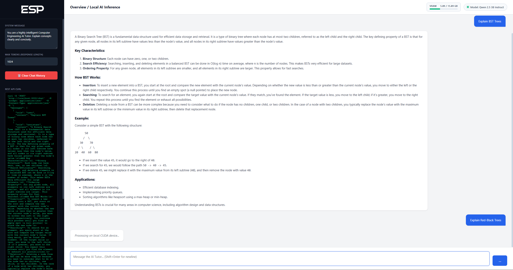
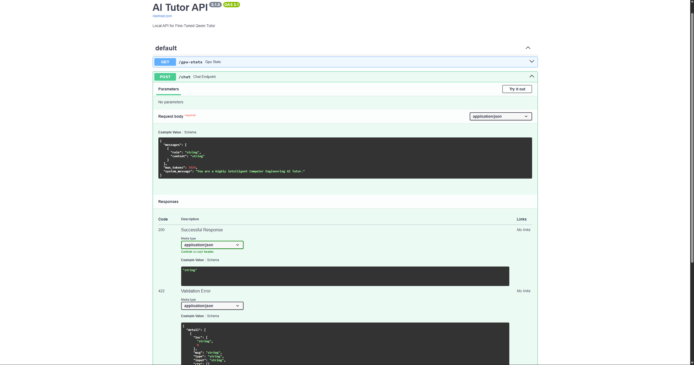
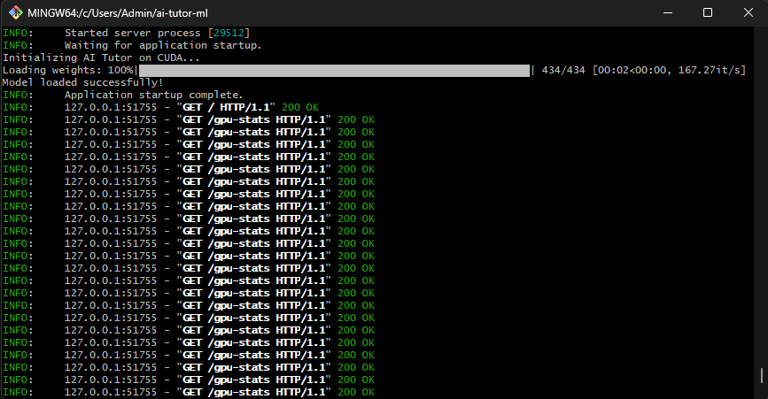

# Local AI Engineering Tutor & API Backend

An end-to-end Machine Learning pipeline and full-stack application built to locally host and serve a Large Language Model (Qwen 3B) as a specialized teaching assistant for University-level Computer Engineering coursework. Built entirely on local hardware (RTX 5070 Ti) to eliminate cloud API costs and ensure data privacy.

## 📸 Project Showcase

### Custom Inference Web UI
A custom-built, dark-mode frontend featuring chat history memory, live MathJax LaTeX rendering, and real-time hardware tracking.

### Live VRAM Tracking & Dynamic cURL
The UI features a background polling script that queries PyTorch's CUDA API to report live GPU memory allocation. The sidebar dynamically generates raw cURL requests based on current chat history and hyperparameter settings.

### FastAPI Swagger Documentation
The inference engine is wrapped in a highly responsive REST API using FastAPI, complete with auto-generated OpenAPI documentation for seamless frontend integration.

### Local CUDA Inference Server
The Uvicorn ASGI server actively loading the 3B parameter model into the RTX 5070 Ti's VRAM and continuously polling hardware telemetry via the PyTorch backend.

## 🚀 Key Features

- **Local Inference Engine:** Hosts a 3-Billion parameter instruction-tuned LLM directly on local hardware using PyTorch and CUDA `float16` precision.
- **Data Engineering Pipeline:** Custom Python scripts utilizing `PyMuPDF` to parse, clean, and chunk textbook PDFs into structured Alpaca-style JSONL instruction pairs for fine-tuning.
- **Hardware Telemetry:** Implements a backend `/gpu-stats` endpoint that directly queries the NVIDIA driver via PyTorch to visualize VRAM capacity and allocation dynamically.
- **Stateful Chat Memory:** API natively accepts and processes conversational history arrays, allowing the LLM to maintain context across complex engineering topics.
- **Mathematical Rendering:** Frontend integrates `MathJax` and `Marked.js` to perfectly parse and display complex differential equations and algorithmic syntax.

## 🛠️ Tech Stack

- **Machine Learning:** PyTorch, Hugging Face (Transformers), CUDA 13.0
- **Backend API:** FastAPI, Uvicorn, Pydantic, Python
- **Frontend:** HTML5, CSS3 Flexbox, Vanilla JavaScript, MathJax
- **Hardware:** NVIDIA RTX 5070 Ti (16GB VRAM)

## ⚙️ How to Run Locally

### 1. Environment Setup
Clone the repository and install the GPU-accelerated dependencies.
\`\`\`bash
python -m venv venv
source venv/Scripts/activate
pip install -r requirements.txt
\`\`\`

### 2. Start the Inference Server
Launch the FastAPI backend. It will automatically download the model weights (if not cached) and load them into CUDA memory.
\`\`\`bash
uvicorn api:app --reload
\`\`\`

### 3. Access the Tutors
- **Interactive UI:** Visit `http://localhost:8000/` in your browser.
- **API Documentation:** Visit `http://localhost:8000/docs` to test endpoints via Swagger.